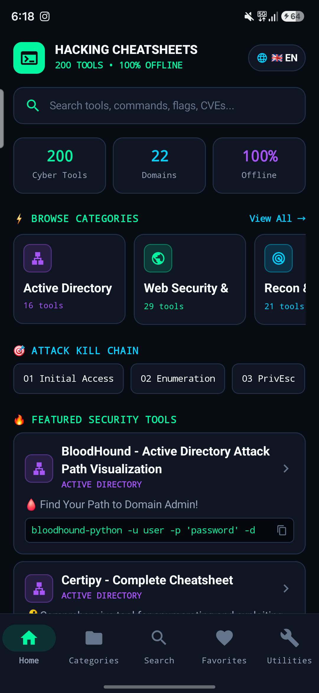
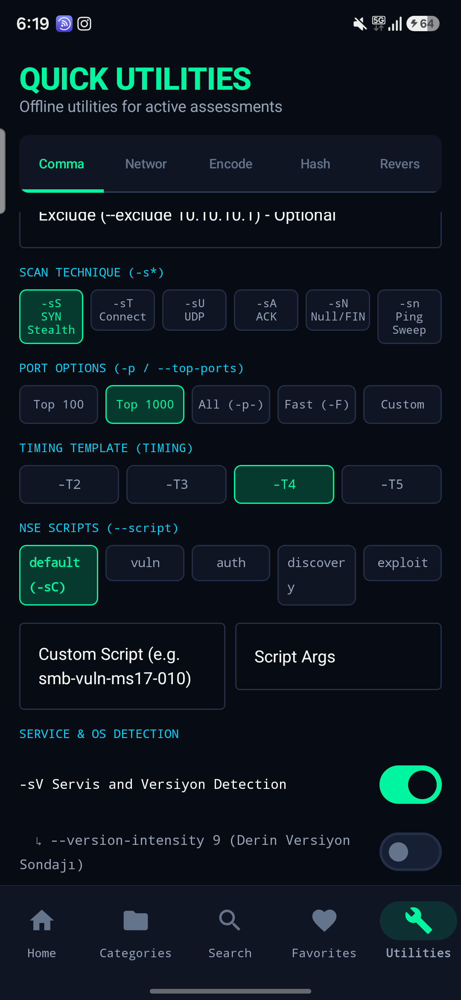
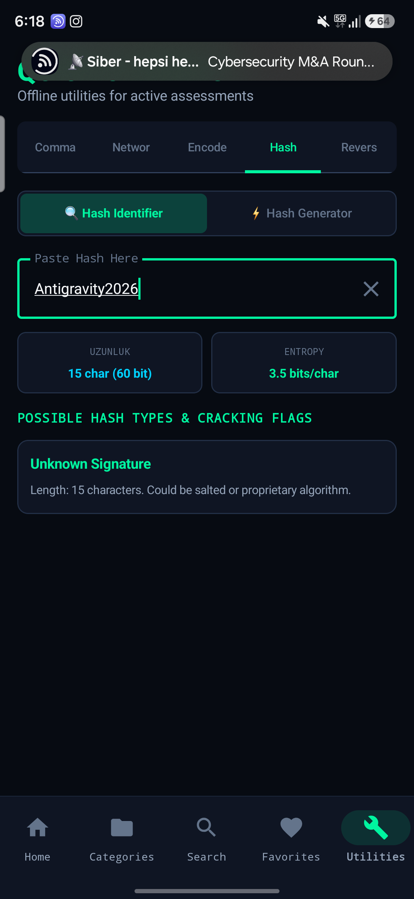
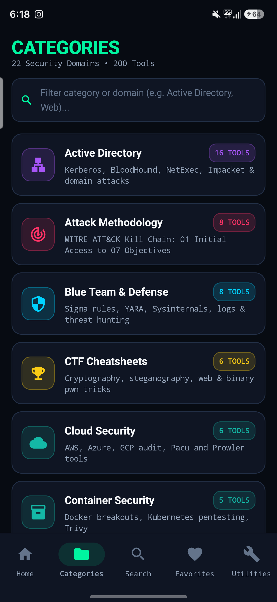
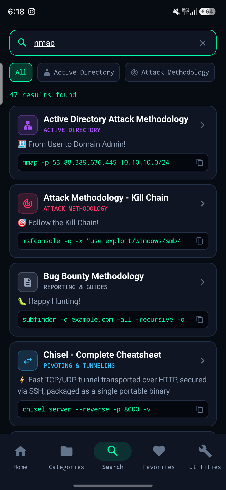
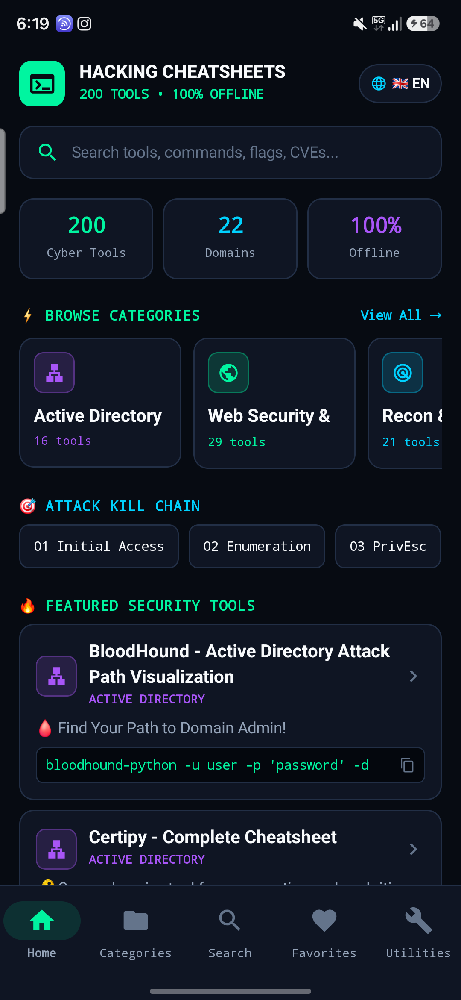

# 🔴 Hacking Cheatsheets

[🇮🇹 Versione Italiana](README.it.md) • [🇹🇷 Türkçe Sürüm](README.tr.md)

```
    ██╗  ██╗ █████╗  ██████╗██╗  ██╗██╗███╗   ██╗ ██████╗ 
    ██║  ██║██╔══██╗██╔════╝██║ ██╔╝██║████╗  ██║██╔════╝ 
    ███████║███████║██║     █████╔╝ ██║██╔██╗ ██║██║  ███╗
    ██╔══██║██╔══██║██║     ██╔═██╗ ██║██║╚██╗██║██║   ██║
    ██║  ██║██║  ██║╚██████╗██║  ██╗██║██║ ╚████║╚██████╔╝
    ╚═╝  ╚═╝╚═╝  ╚═╝ ╚═════╝╚═╝  ╚═╝╚═╝╚═╝  ╚═══╝ ╚═════╝ 
     ██████╗██╗  ██╗███████╗ █████╗ ████████╗███████╗██╗  ██╗███████╗███████╗████████╗███████╗
    ██╔════╝██║  ██║██╔════╝██╔══██╗╚══██╔══╝██╔════╝██║  ██║██╔════╝██╔════╝╚══██╔══╝██╔════╝
    ██║     ███████║█████╗  ███████║   ██║   ███████╗███████║█████╗  █████╗     ██║   ███████╗
    ██║     ██╔══██║██╔══╝  ██╔══██║   ██║   ╚════██║██╔══██║██╔══╝  ██╔══╝     ██║   ╚════██║
    ╚██████╗██║  ██║███████╗██║  ██║   ██║   ███████║██║  ██║███████╗███████╗   ██║   ███████║
     ╚═════╝╚═╝  ╚═╝╚══════╝╚═╝  ╚═╝   ╚═╝   ╚══════╝╚═╝  ╚═╝╚══════╝╚══════╝   ╚═╝   ╚══════╝
```

<p align="center">
  
  
  
  
</p>

<p align="center">
  <b>📚 A comprehensive collection of penetration testing cheatsheets for security professionals</b>
</p>

<p align="center">
  <a href="#-cheatsheets">Cheatsheets</a> •
  <a href="#-quick-start">Quick Start</a> •
  <a href="android/">Android App</a> •
  <a href="#-contributing">Contributing</a> •
  <a href="#-license">License</a>
</p>

---

## 🎯 About

**Hacking Cheatsheets** is a curated collection of quick reference guides for penetration testing and ethical hacking tools. Each cheatsheet provides:

- ✅ **Clear explanations** of tool functionality
- ✅ **Command syntax** with practical examples
- ✅ **Real-world scenarios** and use cases
- ✅ **Quick reference tables** for rapid lookup
- ✅ **Tips & best practices** from experienced pentesters

---

## 🎯 Attack Methodology (Kill Chain)

> **NEW!** Complete step-by-step guide for penetration testing based on MITRE ATT&CK framework.

| Phase | Description | Guide |
|-------|-------------|-------|
| **1. Initial Access** | Exploits, phishing, credentials | [📄 View](./Attack-Methodology/01-Initial-Access.md) |
| **2. Enumeration** | System & network discovery | [📄 View](./Attack-Methodology/02-Enumeration.md) |
| **3. Privilege Escalation** | Get root/SYSTEM access | [📄 View](./Attack-Methodology/03-Privilege-Escalation.md) |
| **4. Lateral Movement** | Move across the network | [📄 View](./Attack-Methodology/04-Lateral-Movement.md) |
| **5. Persistence** | Maintain access | [📄 View](./Attack-Methodology/05-Persistence.md) |
| **6. Defense Evasion** | Bypass AV/EDR/AMSI | [📄 View](./Attack-Methodology/06-Defense-Evasion.md) |
| **7. Actions on Objectives** | Data exfiltration & impact | [📄 View](./Attack-Methodology/07-Actions-Objectives.md) |

👉 **[Full Kill Chain Overview](./Attack-Methodology/README.md)**

---

## 🛡️ Blue Team (Defensive Security)

> **NEW!** Complete defensive security guides for SOC analysts and incident responders.

| Topic | Description | Guide |
|-------|-------------|-------|
| **Incident Response** | IR lifecycle, containment, procedures | [📄 View](./Blue-Team/Incident-Response.md) |
| **Log Analysis** | Windows/Linux log analysis & Event IDs | [📄 View](./Blue-Team/Log-Analysis.md) |
| **SIEM Detection** | Splunk/ELK queries & dashboards | [📄 View](./Blue-Team/SIEM-Detection.md) |
| **Threat Hunting** | Proactive hunting techniques | [📄 View](./Blue-Team/Threat-Hunting.md) |
| **Hardening** | Windows/Linux hardening checklists | [📄 View](./Blue-Team/Hardening.md) |
| **Sigma Rules** | Platform-agnostic detection rules | [📄 View](./Blue-Team/Sigma-Rules.md) |
| **YARA Rules** | Malware & IOC detection patterns | [📄 View](./Blue-Team/YARA-Rules.md) |

👉 **[Full Blue Team Overview](./Blue-Team/README.md)**

---

## ☁️ Cloud Security

> **NEW!** Cloud pentesting guides for AWS, Azure, and GCP.

| Provider / Tool | Description | Guide |
|-----------------|-------------|-------|
| **AWS** | S3, IAM, Lambda, EC2, IMDS | [📄 View](./Cloud-Security/AWS-Pentesting.md) |
| **Azure** | Azure AD, Blob Storage, VMs, Key Vault | [📄 View](./Cloud-Security/Azure-Pentesting.md) |
| **GCP** | GCS, IAM, Compute, Cloud Functions | [📄 View](./Cloud-Security/GCP-Pentesting.md) |
| **Pacu** | The AWS exploitation & privilege escalation framework | [📄 View](./Pacu/README.md) |
| **Prowler** | Multi-cloud CIS benchmark & misconfiguration auditor | [📄 View](./Prowler/README.md) |

👉 **[Full Cloud Security Overview](./Cloud-Security/README.md)**

---

## 📱 Mobile Security

> **NEW!** Mobile app pentesting guides for Android and iOS.

| Platform / Tool | Description | Guide |
|-----------------|-------------|-------|
| **Android** | APK analysis, Frida, root detection bypass | [📄 View](./Mobile-Security/Android-Pentesting.md) |
| **iOS** | IPA analysis, jailbreak, Objection, keychain | [📄 View](./Mobile-Security/iOS-Pentesting.md) |
| **Frida & Objection** | Dynamic binary instrumentation & runtime method hooking | [📄 View](./Frida/README.md) |
| **Jadx & Apktool** | APK decompilation, Smali patching & repackaging | [📄 View](./Jadx/README.md) |

👉 **[Full Mobile Security Overview](./Mobile-Security/README.md)**

---

## 🐳 Container Security

> **NEW!** Docker & Kubernetes pentesting guides.

| Platform | Description | Guide |
|----------|-------------|-------|
| **Docker** | Container escape, image analysis, daemon exploitation | [📄 View](./Container-Security/Docker-Pentesting.md) |
| **Kubernetes** | RBAC bypass, pod escape, secrets extraction | [📄 View](./Container-Security/Kubernetes-Pentesting.md) |
| **Trivy** | Comprehensive container, k8s, secret & SBOM scanner | [📄 View](./Trivy/README.md) |
| **kube-bench** | CIS Kubernetes Benchmark compliance auditor | [📄 View](./kube-bench/README.md) |

👉 **[Full Container Security Overview](./Container-Security/README.md)**

---

## 🎭 Social Engineering

> **NEW!** Social engineering techniques, phishing campaigns, and pretexting guides.

| Topic | Description | Guide |
|-------|-------------|-------|
| **Phishing** | Email phishing, GoPhish, Evilginx2, vishing, smishing | [📄 View](./Social-Engineering/Phishing.md) |
| **Pretexting** | Personas, scenarios, psychological manipulation | [📄 View](./Social-Engineering/Pretexting.md) |

👉 **[Full Social Engineering Overview](./Social-Engineering/README.md)**

---

## 📝 Reporting Templates

> **NEW!** Professional report templates for pentesters and bug bounty hunters.

| Template | Description | Guide |
|----------|-------------|-------|
| **Pentest Report** | Full penetration test report structure | [📄 View](./Reporting/Pentest-Report-Template.md) |
| **Bug Bounty Report** | HackerOne/Bugcrowd submission template | [📄 View](./Reporting/Bug-Bounty-Report-Template.md) |
| **Executive Summary** | Non-technical summary for C-level | [📄 View](./Reporting/Executive-Summary-Template.md) |

---

## 🔍 OSINT (Open Source Intelligence)

> **NEW!** Complete OSINT methodology and tool guides.

| Topic | Description | Guide |
|-------|-------------|-------|
| **People Search** | Find individuals online, phone/address lookup | [📄 View](./OSINT/People-Search.md) |
| **Email OSINT** | Email discovery, breach checking, verification | [📄 View](./OSINT/Email-OSINT.md) |
| **Social Media** | Username search, platform-specific OSINT | [📄 View](./OSINT/Social-Media-OSINT.md) |
| **Domain & IP** | WHOIS, DNS, subdomain, IP reconnaissance | [📄 View](./OSINT/Domain-IP-OSINT.md) |
| **Image OSINT** | Reverse image search, EXIF metadata | [📄 View](./OSINT/Image-OSINT.md) |

👉 **[Full OSINT Overview](./OSINT/README.md)**

---

## 🌐 Network Pentesting

> **NEW!** Complete network penetration testing guides.

| Topic | Description | Guide |
|-------|-------------|-------|
| **Port Scanning** | Nmap, Masscan, RustScan | [📄 View](./Network-Pentesting/Port-Scanning.md) |
| **Network Enumeration** | SMB, SNMP, NFS, LDAP, DNS | [📄 View](./Network-Pentesting/Network-Enumeration.md) |
| **MITM Attacks** | ARP spoofing, DNS spoofing, SSL strip | [📄 View](./Network-Pentesting/MITM-Attacks.md) |
| **Service Exploitation** | FTP, SSH, SMB, RDP, databases | [📄 View](./Network-Pentesting/Service-Exploitation.md) |

👉 **[Full Network Pentesting Overview](./Network-Pentesting/README.md)**

---

## 🏁 CTF Cheatsheets

> **NEW!** Complete CTF competition guides for HackTheBox, TryHackMe, PicoCTF.

| Category | Description | Guide |
|----------|-------------|-------|
| **Web** | SQLi, XSS, SSTI, LFI, Auth bypass | [📄 View](./CTF/Web-CTF.md) |
| **Crypto** | RSA, AES, hashes, encoding, XOR | [📄 View](./CTF/Crypto-CTF.md) |
| **Reverse Engineering** | Ghidra, IDA, GDB, patching | [📄 View](./CTF/Reverse-Engineering-CTF.md) |
| **Forensics** | Steganography, memory, disk, PCAP | [📄 View](./CTF/Forensics-CTF.md) |
| **Pwn/Binary** | Buffer overflow, ROP, shellcode | [📄 View](./CTF/Pwn-CTF.md) |

👉 **[Full CTF Overview](./CTF/README.md)**

---

## 📡 IoT Hacking

> **NEW!** IoT device hacking, firmware analysis, and hardware hacking guides.

| Topic | Description | Guide |
|-------|-------------|-------|
| **Firmware Analysis** | Binwalk, extraction, RE, secrets | [📄 View](./IoT-Hacking/Firmware-Analysis.md) |
| **Hardware Hacking** | UART, JTAG, SPI, I2C, debug ports | [📄 View](./IoT-Hacking/Hardware-Hacking.md) |

👉 **[Full IoT Hacking Overview](./IoT-Hacking/README.md)**

---

## 📖 Cheatsheets

### 🔴 Exploitation Framework

| Tool | Description | Cheatsheet |
|------|-------------|------------|
| **Metasploit Framework** | The world's most used penetration testing framework | [📄 View](./Metasploit/README.md) |
| **Meterpreter** | Advanced post-exploitation payload | [📄 View](./Metasploit/Meterpreter.md) |
| **Msfvenom** | Standalone payload generator, bad chars & shellcode encoders | [📄 View](./Msfvenom/README.md) |
| **Sliver C2** | Modern open-source cross-platform Command & Control framework | [📄 View](./Sliver/README.md) |
| **Mimikatz** | Windows credential extraction tool | [📄 View](./Mimikatz/README.md) |
| **PowerShell** | Windows scripting for pentesting | [📄 View](./PowerShell/README.md) |
| **Linux Commands** | Linux & Bash for pentesting | [📄 View](./Linux-Commands/README.md) |
| **rlwrap** | Readline wrapper for reverse shells & dumb terminals | [📄 View](./rlwrap/README.md) |
| **Netcat (nc)** | The TCP/IP Swiss Army Knife for raw network sockets & reverse shells | [📄 View](./Netcat/README.md) |
| **Socat** | Bidirectional socket relay & fully interactive TTY shells | [📄 View](./Socat/README.md) |
| **Searchsploit** | Offline Exploit-DB search engine & PoC extractor | [📄 View](./Searchsploit/README.md) |

### 🔍 Reconnaissance & Scanning

| Tool | Description | Cheatsheet |
|------|-------------|------------|
| **Nmap** | Network discovery and security auditing | [📄 View](./Nmap/README.md) |
| **RustScan** | Ultra-fast port scanner (65k ports in 3s) piped to Nmap | [📄 View](./RustScan/README.md) |
| **Masscan** | Asynchronous Internet-scale TCP port scanner | [📄 View](./Masscan/README.md) |
| **Naabu** | Fast SYN/CONNECT port scanner optimized for pipeline automation | [📄 View](./Naabu/README.md) |
| **WhatWeb** | Next-generation web scanner & technology stack fingerprinter | [📄 View](./WhatWeb/README.md) |
| **Gobuster** | Directory/DNS/VHost brute-forcing | [📄 View](./Gobuster/README.md) |
| **Feroxbuster** | Fast, recursive web content discovery | [📄 View](./Feroxbuster/README.md) |
| **dirsearch** | Advanced web path brute-forcer & crawler | [📄 View](./dirsearch/README.md) |
| **Dirb** | Web content scanner & dictionary crawler | [📄 View](./Dirb/README.md) |
| **Nikto** | Web server scanner | [📄 View](./Nikto/README.md) |
| **dnsrecon** | Advanced DNS reconnaissance, zone transfer & SRV enum | [📄 View](./dnsrecon/README.md) |

### 🌐 Web Application Testing

| Tool | Description | Cheatsheet |
|------|-------------|------------|
| **SQLMap** | SQL injection automation tool | [📄 View](./SQLMap/README.md) |
| **Commix** | Automated OS command injection exploitation engine | [📄 View](./Commix/README.md) |
| **Tplmap** | Automated Server-Side Template Injection (SSTI) exploiter | [📄 View](./Tplmap/README.md) |
| **Burp Suite** | Web application security testing platform | [📄 View](./Burp-Suite/README.md) |
| **OWASP ZAP** | Free web app security scanner | [📄 View](./OWASP-ZAP/README.md) |
| **WPScan** | Black box WordPress security & vulnerability scanner | [📄 View](./WPScan/README.md) |
| **Kiterunner** | Context-aware REST and GraphQL API endpoint discovery | [📄 View](./Kiterunner/README.md) |
| **Wfuzz** | Flexible web fuzzer & parameter explorer | [📄 View](./Wfuzz/README.md) |
| **jwt_tool** | Comprehensive JWT manipulation, crack & spoofing toolkit | [📄 View](./jwt_tool/README.md) |
| **smuggler** | Fast HTTP request smuggling (CL.TE/TE.CL) scanner | [📄 View](./smuggler/README.md) |
| **CORSy** | Cross-Origin Resource Sharing (CORS) misconfiguration scanner | [📄 View](./CORSy/README.md) |
| **InQL** | Advanced GraphQL security scanner & introspection analyzer | [📄 View](./InQL/README.md) |
| **wafw00f** | Web Application Firewall (WAF) fingerprinting & detection | [📄 View](./wafw00f/README.md) |

### 🔓 Password Cracking

| Tool | Description | Cheatsheet |
|------|-------------|------------|
| **Hydra** | Fast network login cracker | [📄 View](./Hydra/README.md) |
| **John the Ripper** | Legendary password cracker | [📄 View](./John-The-Ripper/README.md) |
| **Hashcat** | World's fastest GPU password cracker | [📄 View](./Hashcat/README.md) |
| **CeWL** | Custom wordlist generator & corporate website spider | [📄 View](./CeWL/README.md) |
| **Crunch** | Pattern and charset based password wordlist generator | [📄 View](./Crunch/README.md) |
| **name-that-hash** | Fast hash identifier with Hashcat & John format mapping | [📄 View](./name-that-hash/README.md) |
| **CUPP** | Common User Passwords Profiler (custom targeted wordlists) | [📄 View](./CUPP/README.md) |
| **fcrackzip** | Fast multi-threaded password cracker for ZIP archives | [📄 View](./fcrackzip/README.md) |

### 📡 Network Analysis

| Tool | Description | Cheatsheet |
|------|-------------|------------|
| **Wireshark** | Network protocol analyzer | [📄 View](./Wireshark/README.md) |
| **tshark** | Command-line network protocol analyzer & packet dissector | [📄 View](./tshark/README.md) |
| **tcpdump** | Command-line packet analyzer | [📄 View](./tcpdump/README.md) |
| **mitmproxy** | Interactive SSL/TLS-capable HTTP/HTTPS proxy & scriptable flow | [📄 View](./mitmproxy/README.md) |
| **Scapy** | Interactive packet manipulation, crafting & dissection library | [📄 View](./Scapy/README.md) |
| **Ettercap** | Comprehensive LAN MITM, ARP poisoning & packet filter suite | [📄 View](./Ettercap/README.md) |
| **Yersinia** | Layer-2 protocol attack framework (STP, CDP, DTP, DHCP) | [📄 View](./Yersinia/README.md) |

### 🐛 Bug Bounty

| Tool | Description | Cheatsheet |
|------|-------------|------------|
| **⭐ BB Methodology** | Complete bug bounty hunting guide | [📄 View](./Bug-Bounty-Methodology/README.md) |
| **Nuclei** | Template-based vulnerability scanner | [📄 View](./Nuclei/README.md) |
| **ffuf** | Fast web fuzzer | [📄 View](./ffuf/README.md) |
| **dnsx** | Fast & multipurpose DNS resolution and wildcard filter | [📄 View](./dnsx/README.md) |
| **Subfinder** | Subdomain discovery | [📄 View](./Subfinder/README.md) |
| **httpx** | HTTP probe & toolkit | [📄 View](./httpx/README.md) |
| **Amass** | In-depth attack surface mapping | [📄 View](./Amass/README.md) |
| **GAU** | Get All URLs from archives | [📄 View](./GAU/README.md) |
| **Katana** | Next-gen web crawler | [📄 View](./Katana/README.md) |
| **Arjun** | Hidden parameter discovery | [📄 View](./Arjun/README.md) |
| **Dalfox** | XSS vulnerability scanner | [📄 View](./Dalfox/README.md) |

### 💉 Payloads Collection

| Vulnerability | Description | Cheatsheet |
|---------------|-------------|------------|
| **XSS** | Cross-Site Scripting payloads | [📄 View](./Payloads/XSS.md) |
| **SQLi** | SQL Injection payloads | [📄 View](./Payloads/SQLi.md) |
| **LFI** | Local File Inclusion payloads | [📄 View](./Payloads/LFI.md) |
| **SSTI** | Server-Side Template Injection | [📄 View](./Payloads/SSTI.md) |
| **Command Injection** | OS command injection payloads | [📄 View](./Payloads/Command-Injection.md) |
| **NoSQL Injection** | MongoDB, CouchDB, Redis payloads | [📄 View](./Payloads/NoSQL-Injection.md) |
| **Deserialization** | Java, PHP, Python, .NET payloads | [📄 View](./Payloads/Deserialization.md) |
| **WebSocket Attacks** | CSWSH, injection, hijacking | [📄 View](./Payloads/WebSocket-Attacks.md) |
| **GraphQL Injection** | Introspection, IDOR, injection | [📄 View](./Payloads/GraphQL-Injection.md) |

### 🔴 Web Vulnerabilities

| Vulnerability | Description | Cheatsheet |
|---------------|-------------|------------|
| **API Security** | REST/GraphQL/JWT testing guide | [📄 View](./API-Security/README.md) |
| **IDOR** | Insecure Direct Object Reference | [📄 View](./IDOR/README.md) |
| **SSRF** | Server-Side Request Forgery | [📄 View](./SSRF/README.md) |
| **XXE** | XML External Entity Injection | [📄 View](./XXE/README.md) |
| **Race Conditions** | Timing & concurrency attacks | [📄 View](./Race-Conditions/README.md) |
| **Auth Bypass** | Authentication bypass techniques | [📄 View](./Auth-Bypass/README.md) |
| **CORS** | Cross-Origin misconfigurations | [📄 View](./CORS/README.md) |
| **JWT Attacks** | Token manipulation & key attacks | [📄 View](./JWT-Attacks/README.md) |
| **Open Redirect** | URL redirect vulnerabilities | [📄 View](./Open-Redirect/README.md) |

### 🛡️ Advanced Attack Techniques

| Topic | Description | Cheatsheet |
|-------|-------------|------------|
| **WAF Bypass** | Origin IP discovery & WAF evasion | [📄 View](./WAF-Bypass/README.md) |
| **Cloudflare Bypass** | Find origin IP behind Cloudflare | [📄 View](./Cloudflare-Bypass/README.md) |
| **Subdomain Takeover** | Dangling CNAME exploitation | [📄 View](./Subdomain-Takeover/README.md) |
| **Cache Poisoning** | Web cache poisoning & deception | [📄 View](./Cache-Poisoning/README.md) |
| **HTTP Smuggling** | Request smuggling (CL.TE/TE.CL) | [📄 View](./HTTP-Request-Smuggling/README.md) |
| **Prototype Pollution** | JavaScript prototype attacks | [📄 View](./Prototype-Pollution/README.md) |

### 🔎 Dorking & OSINT

| Tool | Description | Cheatsheet |
|------|-------------|------------|
| **Google Dorking** | Advanced Google search techniques | [📄 View](./Google-Dorking/README.md) |
| **Shodan** | IoT & device search engine | [📄 View](./Shodan/README.md) |
| **GitHub Dorking** | Secret hunting in repositories | [📄 View](./GitHub-Dorking/README.md) |
| **TruffleHog** | Find leaked credentials & API keys with live verification | [📄 View](./TruffleHog/README.md) |
| **Gitleaks** | Fast secret detection in git repos, commit histories & files | [📄 View](./Gitleaks/README.md) |
| **theHarvester** | OSINT gathering for emails, subdomains, hosts & employee names | [📄 View](./theHarvester/README.md) |
| **Sherlock** | Social media account hunter across 400+ platforms | [📄 View](./Sherlock/README.md) |
| **GitTools** | Exploit publicly exposed .git repositories (dumper, extractor) | [📄 View](./GitTools/README.md) |

### 🔝 Privilege Escalation

| Topic | Description | Cheatsheet |
|-------|-------------|------------|
| **PEASS-ng** | LinPEAS & WinPEAS automated privilege auditing | [📄 View](./PEASS-ng/README.md) |
| **LOLBAS & GTFOBins** | Living off the land binaries & scripts | [📄 View](./LOLBAS-GTFOBins/README.md) |
| **Linux PrivEsc** | Linux privilege escalation techniques | [📄 View](./Linux-PrivEsc/README.md) |
| **Windows PrivEsc** | Windows privilege escalation techniques | [📄 View](./Windows-PrivEsc/README.md) |
| **LaZagne** | Post-exploitation password recovery for browsers, Wi-Fi & sysadmin | [📄 View](./LaZagne/README.md) |
| **pypykatz** | Pure Python offline Mimikatz & LSASS dump parser | [📄 View](./pypykatz/README.md) |

### 🔬 Digital Forensics

| Tool | Description | Cheatsheet |
|------|-------------|------------|
| **Volatility** | Memory forensics framework | [📄 View](./Volatility/README.md) |
| **Autopsy** | Digital forensics platform (GUI) | [📄 View](./Autopsy/README.md) |
| **ExifTool** | Metadata extraction & analysis | [📄 View](./ExifTool/README.md) |
| **Binwalk** | Firmware analysis & extraction | [📄 View](./Binwalk/README.md) |

### 🔄 Reverse Engineering

| Tool | Description | Cheatsheet |
|------|-------------|------------|
| **Radare2 (r2)** | Powerful UNIX-like CLI reverse engineering & binary analysis framework | [📄 View](./Radare2/README.md) |
| **pwndbg & GEF** | Next-gen terminal GDB enhancements for reversing & binary exploitation | [📄 View](./pwndbg-GEF/README.md) |
| **strace & ltrace** | Dynamic binary analysis: system call and library call tracing | [📄 View](./strace-ltrace/README.md) |
| **Ropper** | Advanced ROP/JOP gadget finder and chain generator (NX bypass) | [📄 View](./Ropper/README.md) |
| **checksec & Binutils** | ELF mitigation auditing (Canary, NX, PIE, RELRO) & header dissection | [📄 View](./checksec/README.md) |
| **Ghidra** | NSA reverse engineering suite | [📄 View](./Ghidra/README.md) |
| **GDB** | GNU Debugger (Linux debugging) | [📄 View](./GDB/README.md) |
| **x64dbg** | Windows x64/x32 debugger | [📄 View](./x64dbg/README.md) |
| **pwntools** | Premier Python CTF & binary exploitation framework | [📄 View](./pwntools/README.md) |

### 📶 WiFi Hacking

| Tool | Description | Cheatsheet |
|------|-------------|------------|
| **Aircrack-ng** | WiFi hacking suite (WPA/WPA2) | [📄 View](./Aircrack-ng/README.md) |
| **Wifite** | Automated WiFi auditor | [📄 View](./Wifite/README.md) |
| **Bettercap** | Network attack framework (MITM/WiFi) | [📄 View](./Bettercap/README.md) |
| **hcxdumptool** | Clientless PMKID Wi-Fi packet capture for Hashcat mode 22000 | [📄 View](./hcxdumptool/README.md) |
| **Reaver** | WPS PIN brute-forcing & Pixie Dust attack suite | [📄 View](./Reaver/README.md) |

### 🔄 Pivoting & Tunneling

| Tool | Description | Cheatsheet |
|------|-------------|------------|
| **Ligolo-ng** | Advanced TUN-based pivoting & internal routing | [📄 View](./Ligolo-ng/README.md) |
| **Chisel** | Fast TCP/UDP tunnel over HTTP via SSH | [📄 View](./Chisel/README.md) |
| **SSH-Tunneling** | Local (-L), Remote (-R), Dynamic (-D) & proxychains-ng | [📄 View](./SSH-Tunneling/README.md) |
| **Proxychains** | Dynamic SOCKS/HTTP proxy chaining via LD_PRELOAD | [📄 View](./Proxychains/README.md) |
| **sshuttle** | Transparent subnet VPN over standard unprivileged SSH | [📄 View](./sshuttle/README.md) |

### 🏢 Active Directory

| Tool | Description | Cheatsheet |
|------|-------------|------------|
| **⭐ AD Methodology** | Step-by-step attack guide | [📄 View](./AD-Attack-Methodology/README.md) |
| **NetExec (nxc)** | Modern network & Active Directory swiss army knife | [📄 View](./NetExec/README.md) |
| **adidnsdump** | Dump Active Directory Integrated DNS records over LDAP | [📄 View](./adidnsdump/README.md) |
| **Certipy** | Active Directory Certificate Services (AD CS) abuse | [📄 View](./Certipy/README.md) |
| **PKINITtools** | Kerberos PKINIT ticket requests & UnPAC-the-hash toolkit | [📄 View](./PKINITtools/README.md) |
| **Coercer** | Multi-protocol Windows authentication coercion engine | [📄 View](./Coercer/README.md) |
| **Snaffler** | SMB share crawler for KeePass, config files & cleartext creds | [📄 View](./Snaffler/README.md) |
| **BloodHound** | AD attack path visualization | [📄 View](./BloodHound/README.md) |
| **Impacket** | Python AD attack toolkit | [📄 View](./Impacket/README.md) |
| **CrackMapExec** | AD Swiss Army knife | [📄 View](./CrackMapExec/README.md) |
| **Rubeus** | Kerberos abuse toolkit | [📄 View](./Rubeus/README.md) |
| **PowerView** | PowerShell AD enumeration | [📄 View](./PowerView/README.md) |
| **Responder** | LLMNR/NBT-NS poisoning | [📄 View](./Responder/README.md) |
| **Evil-WinRM** | WinRM shell for pentesters | [📄 View](./Evil-WinRM/README.md) |
| **Kerbrute** | Kerberos user enum & spray | [📄 View](./Kerbrute/README.md) |
| **enum4linux-ng** | Next-generation Windows & Samba SMB/RPC enumeration | [📄 View](./enum4linux-ng/README.md) |

### 📚 Resources

| Resource | Description | Cheatsheet |
|----------|-------------|------------|
| **Wordlists** | Complete wordlist reference guide | [📄 View](./Wordlists/README.md) |
| **Kali Linux Tools** | 600+ tools by category | [📄 View](./Kali-Linux-Tools/README.md) |

---

## 🚀 Quick Start

### Clone the Repository

```bash
git clone https://github.com/Ilias1988/Hacking-Cheatsheets.git
cd Hacking-Cheatsheets
```

### Browse Cheatsheets

Navigate to any tool folder and open the README.md file:

```bash
# View Metasploit cheatsheet
cat Metasploit/README.md

# Or open in your favorite editor
code Metasploit/
```

### 📱 Android Mobile Application & CLI Command Builder

All cheatsheets are in Markdown format, and a powerful native **Android application** is included directly in this repository ([`android/`](android/)):

- 📱 **Native Jetpack Compose Architecture:** Ultra-fast, offline-first dark terminal UI with Material 3 styling.
- 🛠️ **109 Interactive CLI Command Builders:** Real-time flag configuration, switches, toggle chips, target inputs, and dynamic syntax-highlighted 1-tap command generation across 10 security domains (Nmap, Nuclei, Hashcat, Ligolo-ng, BloodHound, NetExec, Metasploit, etc.).
- ⚡ **Live Multi-Algorithm Hash Generator & Identifier:**
  - **Instant Plaintext Hashing:** MD5, NTLM (SAM / Active Directory), SHA-1, SHA-256, SHA-512, SHA-384, SHA-224, SHA3-256 (Keccak / Web3), CRC32.
  - **Salt & Keyed Hashes:** Custom salt prefix/suffix positioning and HMAC secrets (HMAC-MD5, HMAC-SHA1, HMAC-SHA256, HMAC-SHA512).
  - **Entropy & Identifier:** Automatic hash classification by length and Shannon entropy with Hashcat mode (`-m`) references.
- 🌐 **100% Bilingual Support (🇬🇧 EN / 🇹🇷 TR):** Seamless 1-tap language toggle across the entire application — 200 cheatsheet guides, 109 command builders, toggle chips, option flags, input fields, and utility engines.
- 🔍 **Instant Full-Text Search:** Sub-second search across 200 security guides and 12 categorized attack/defense domains.
- 🛠️ **Field Utilities Suite:** Interactive Reverse Shell generator (Bash, Python, Netcat, PowerShell, Socat, Perl, PHP), BPF tcpdump/tshark filter generator, UFW firewall rule builder, and encoders/decoders (Base64, URL, Hex).
- 📦 **Pre-built APK:** Ready-to-install signed APK (v2/v3 scheme) available on [GitHub Releases](https://github.com/cihan-atas/Hacking-Cheatsheets/releases/tag/v1.1.0) (`Hacking-Cheatsheets.apk`).
- 🔨 **Build from Source:**
  ```bash
  cd android
  export JAVA_HOME=/usr/lib/jvm/java-17-openjdk-amd64
  ./gradlew assembleRelease
  # Signed APK: android/app/build/outputs/apk/release/app-release.apk
  ```

#### 📸 Application Screenshots

<p align="center">
  
  
  
</p>
<p align="center">
  
  
  
</p>

---

## 📂 Repository Structure

```
Hacking-Cheatsheets/
│
├── README.md                # This file - Main index
├── README.it.md             # Italian translation - Main index
├── LICENSE                  # MIT License
├── CONTRIBUTING.md          # Contribution guidelines
├── CONTRIBUTING.it.md       # Italian contribution guidelines
├── .gitignore               # Git ignore rules
│
├── Metasploit/              # Metasploit Framework
│   ├── README.md            # Complete msfconsole guide
│   └── Meterpreter.md       # Meterpreter cheatsheet
│
├── Nmap/                    # Network Scanner
│   └── README.md            # Complete Nmap guide
│
├── Gobuster/                # Directory/DNS Enumeration
│   └── README.md            # Complete Gobuster guide
│
├── Feroxbuster/             # Recursive Content Discovery
│   └── README.md            # Complete Feroxbuster guide
│
├── dirsearch/               # Advanced Web Path Brute-Forcer
│   └── README.md            # Complete dirsearch guide
│
├── Dirb/                    # Web Content Scanner
│   └── README.md            # Complete Dirb guide
│
├── Nikto/                   # Web Server Scanner
│   └── README.md            # Complete Nikto guide
│
├── SQLMap/                  # SQL Injection Tool
│   └── README.md            # Complete SQLMap guide
│
├── Burp-Suite/              # Web Application Testing
│   └── README.md            # Complete Burp Suite guide
│
├── OWASP-ZAP/               # OWASP Zed Attack Proxy
│   └── README.md            # Complete ZAP guide
│
├── Hydra/                   # Network Login Cracker
│   └── README.md            # Complete Hydra guide
│
├── John-The-Ripper/         # Password Cracker
│   └── README.md            # Complete John guide
│
├── Hashcat/                 # GPU Password Cracker
│   └── README.md            # Complete Hashcat guide
│
├── Wireshark/               # Network Protocol Analyzer
│   └── README.md            # Complete Wireshark guide
│
├── tcpdump/                 # Command-Line Packet Analyzer
│   └── README.md            # Complete tcpdump guide
│
├── tshark/                  # Terminal Packet Analyzer & Dissector
│   └── README.md            # Complete tshark guide
│
├── rlwrap/                  # Readline Wrapper for Reverse Shells
│   └── README.md            # Complete rlwrap guide
│
├── Netcat/                  # TCP/IP Swiss Army Knife & Raw Sockets
│   └── README.md            # Complete Netcat guide
│
├── Socat/                   # Bidirectional Socket Relay & Full PTY Shells
│   └── README.md            # Complete Socat guide
│
├── Proxychains/             # Dynamic SOCKS/HTTP Proxy Wrapper
│   └── README.md            # Complete Proxychains guide
│
├── sshuttle/                # Transparent Subnet VPN over SSH
│   └── README.md            # Complete sshuttle guide
│
├── RustScan/                # Ultra-Fast 3-Second Port Scanner
│   └── README.md            # Complete RustScan guide
│
├── Masscan/                 # Asynchronous Internet-Scale Port Scanner
│   └── README.md            # Complete Masscan guide
│
├── WPScan/                  # WordPress Security & Vulnerability Scanner
│   └── README.md            # Complete WPScan guide
│
├── Kiterunner/              # Context-Aware API Route Discovery Engine
│   └── README.md            # Complete Kiterunner guide
│
├── Wfuzz/                   # Web Application Fuzzer & Parameter Explorer
│   └── README.md            # Complete Wfuzz guide
│
├── dnsx/                    # Fast DNS Toolkit & Wildcard Filter
│   └── README.md            # Complete dnsx guide
│
├── Snaffler/                # SMB Share Secret & Credential Hunter
│   └── README.md            # Complete Snaffler guide
│
├── Coercer/                 # Multi-Protocol Windows Coercion Engine
│   └── README.md            # Complete Coercer guide
│
├── PKINITtools/             # Kerberos PKINIT & UnPAC-the-Hash Toolkit
│   └── README.md            # Complete PKINITtools guide
│
├── CeWL/                    # Custom Wordlist Generator from Websites
│   └── README.md            # Complete CeWL guide
│
├── Crunch/                  # Pattern-Based Wordlist Generator
│   └── README.md            # Complete Crunch guide
│
├── TruffleHog/              # Live-Verified Leaked Secret Scanner
│   └── README.md            # Complete TruffleHog guide
│
├── Gitleaks/                # Git Secret & API Key Hunter
│   └── README.md            # Complete Gitleaks guide
│
├── Commix/                  # OS Command Injection Exploiter
│   └── README.md            # Complete Commix guide
│
├── Tplmap/                  # SSTI Exploitation Tool
│   └── README.md            # Complete Tplmap guide
│
├── WhatWeb/                 # Web Technology Fingerprinter
│   └── README.md            # Complete WhatWeb guide
│
├── Naabu/                   # Fast SYN/CONNECT Port Scanner
│   └── README.md            # Complete Naabu guide
│
├── adidnsdump/              # Active Directory DNS Dump over LDAP
│   └── README.md            # Complete adidnsdump guide
│
├── SSH-Tunneling/           # Port Forwarding & Proxychains
│   └── README.md            # Complete SSH Tunneling guide
│
├── Frida/                   # Mobile Dynamic Instrumentation
│   └── README.md            # Complete Frida & Objection guide
│
├── Jadx/                    # Android APK Decompilation & Smali
│   └── README.md            # Complete Jadx & Apktool guide
│
├── Msfvenom/                # Metasploit Standalone Payloads
│   └── README.md            # Complete Msfvenom guide
│
├── Sliver/                  # Bishop Fox C2 Framework
│   └── README.md            # Complete Sliver C2 guide
│
├── Pacu/                    # AWS Exploitation Framework
│   └── README.md            # Complete Pacu guide
│
├── Prowler/                 # Multi-Cloud CIS Benchmark Auditor
│   └── README.md            # Complete Prowler guide
│
├── Radare2/                 # UNIX-like CLI Reversing Framework
│   └── README.md            # Complete Radare2 guide
│
├── strace-ltrace/           # Dynamic Syscall & Library Tracer
│   └── README.md            # Complete strace & ltrace guide
│
├── pwndbg-GEF/              # GDB Binary Exploitation Enhancements
│   └── README.md            # Complete pwndbg & GEF guide
│
├── Ropper/                  # ROP/JOP Gadget Finder & Chainer
│   └── README.md            # Complete Ropper guide
│
├── checksec/                # Binary Mitigation & ELF Auditor
│   └── README.md            # Complete checksec & binutils guide
│
├── Nuclei/                  # Bug Bounty Scanner
│   └── README.md            # Complete Nuclei guide
│
├── ffuf/                    # Web Fuzzer
│   └── README.md            # Complete ffuf guide
│
├── Subfinder/               # Subdomain Discovery
│   └── README.md            # Complete Subfinder guide
│
├── httpx/                   # HTTP Probe & Toolkit
│   └── README.md            # Complete httpx guide
│
├── Google-Dorking/          # Google Search Hacking
│   └── README.md            # Complete Google Dorking guide
│
├── Shodan/                  # IoT Search Engine
│   └── README.md            # Complete Shodan guide
│
├── GitHub-Dorking/          # Secret Hunting
│   └── README.md            # Complete GitHub Dorking guide
│
├── jwt_tool/                # JWT Manipulation & Cracking
│   └── README.md            # Complete jwt_tool guide
│
├── GitTools/                # Exposed .git Directory Exploiter
│   └── README.md            # Complete GitTools guide
│
├── smuggler/                # HTTP Request Smuggling Scanner
│   └── README.md            # Complete smuggler guide
│
├── CORSy/                   # CORS Misconfiguration Scanner
│   └── README.md            # Complete CORSy guide
│
├── InQL/                    # GraphQL Security & Introspection
│   └── README.md            # Complete InQL guide
│
├── mitmproxy/               # Interactive SSL/TLS Interception Proxy
│   └── README.md            # Complete mitmproxy guide
│
├── Scapy/                   # Interactive Packet Manipulation & Crafting
│   └── README.md            # Complete Scapy guide
│
├── Ettercap/                # LAN MITM, ARP Poisoning & Sniffer
│   └── README.md            # Complete Ettercap guide
│
├── Yersinia/                # Layer-2 Protocol Attack Framework
│   └── README.md            # Complete Yersinia guide
│
├── name-that-hash/          # Hash Identification & Crack Mapping
│   └── README.md            # Complete Name-That-Hash guide
│
├── LaZagne/                 # Multi-Platform Credential Harvester
│   └── README.md            # Complete LaZagne guide
│
├── CUPP/                    # Common User Passwords Profiler
│   └── README.md            # Complete CUPP guide
│
├── fcrackzip/               # Fast CLI ZIP Password Cracker
│   └── README.md            # Complete fcrackzip guide
│
├── theHarvester/            # Public OSINT Reconnaissance Suite
│   └── README.md            # Complete theHarvester guide
│
├── Sherlock/                # 400+ Social Media Handle Hunter
│   └── README.md            # Complete Sherlock guide
│
├── dnsrecon/                # DNS Enumeration & Zone Transfers
│   └── README.md            # Complete dnsrecon guide
│
├── hcxdumptool/             # Clientless PMKID Wi-Fi Capture
│   └── README.md            # Complete hcxdumptool guide
│
├── Reaver/                  # WPS PIN & Pixie Dust Attack
│   └── README.md            # Complete Reaver guide
│
├── Trivy/                   # Container, K8s & SBOM Scanner
│   └── README.md            # Complete Trivy guide
│
├── kube-bench/              # CIS Kubernetes Benchmark Auditor
│   └── README.md            # Complete kube-bench guide
│
├── Searchsploit/            # Offline Exploit-DB Search
│   └── README.md            # Complete Searchsploit guide
│
├── enum4linux-ng/           # Next-Gen SMB & RPC Enumeration
│   └── README.md            # Complete enum4linux-ng guide
│
├── pwntools/                # Python CTF & Binary Exploitation
│   └── README.md            # Complete pwntools guide
│
├── pypykatz/                # Pure Python Offline Mimikatz
│   └── README.md            # Complete pypykatz guide
│
├── wafw00f/                 # WAF Fingerprinting & Detection
│   └── README.md            # Complete wafw00f guide
│
└── ...
```

---

## 🤝 Contributing

Contributions are welcome! Please read our [Contributing Guidelines](CONTRIBUTING.md) before submitting a pull request.

### Ways to Contribute

- 📝 **Add new cheatsheets** for tools not yet covered
- 🔧 **Improve existing cheatsheets** with better examples
- 🐛 **Report issues** or suggest improvements
- 🌐 **Translate** cheatsheets to other languages
- ⭐ **Star this repo** to show your support!

---

## ⚠️ Legal Disclaimer

> **IMPORTANT:** These cheatsheets are intended for **educational purposes** and **authorized security testing only**. 
> 
> - ✅ Use on systems you own
> - ✅ Use with explicit written permission
> - ✅ Use in legal penetration testing engagements
> - ❌ Never use for unauthorized access
> - ❌ Never use for malicious purposes
> 
> **Unauthorized access to computer systems is illegal.** The authors are not responsible for any misuse of this information.

---

## 📜 License

This project is licensed under the MIT License - see the [LICENSE](LICENSE) file for details.

---

## 🌟 Show Your Support

If you find these cheatsheets useful, please consider:

- ⭐ **Starring** this repository
- 🍴 **Forking** to contribute
- 📢 **Sharing** with fellow security professionals
- 💬 **Providing feedback** for improvements

---

## 📬 Contact

- **GitHub Issues** - For bug reports and feature requests
- **Pull Requests** - For contributions

---

<p align="center">
  <b>Happy Hacking! 🔴</b><br>
  <i>Remember: Hack responsibly, hack ethically!</i>
</p>

---

<p align="center">
  Made with ❤️ for the cybersecurity community
</p>
