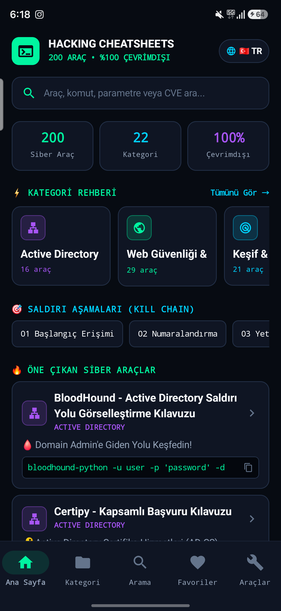
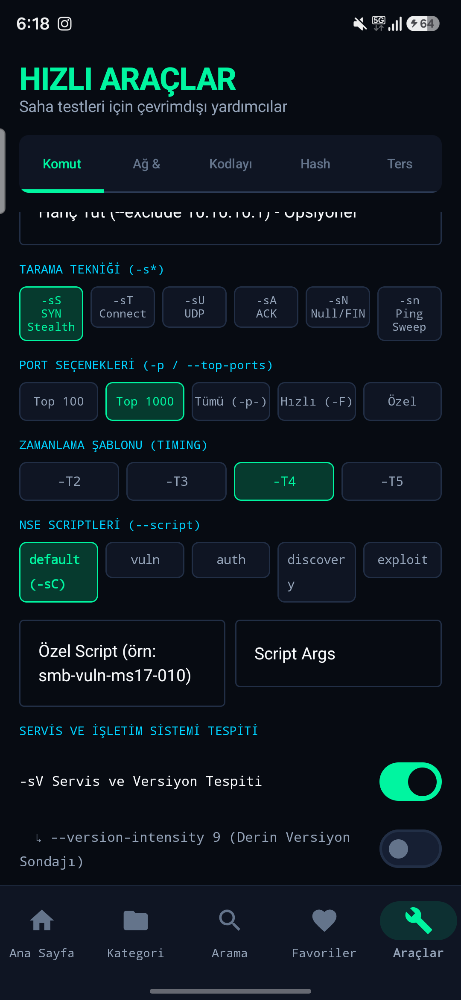
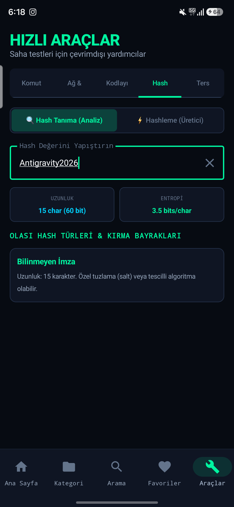
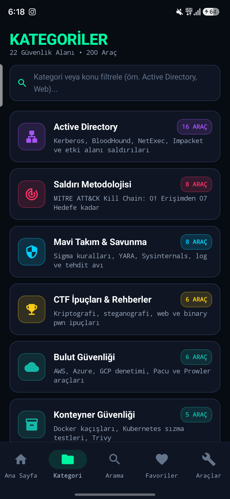
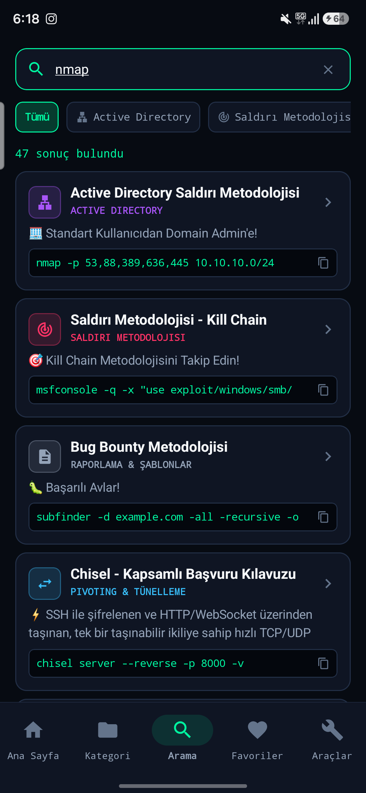

# 🔴 Hacking Cheatsheets

[🇬🇧 English](README.md) • [🇮🇹 Versione Italiana](README.it.md)

```
    ██╗  ██╗ █████╗  ██████╗██╗  ██╗██╗███╗   ██╗ ██████╗ 
    ██║  ██║██╔══██╗██╔════╝██║ ██╔╝██║████╗  ██║██╔════╝ 
    ███████║███████║██║     █████╔╝ ██║██╔██╗ ██║██║  ███╗
    ██╔══██║██╔══██║██║     ██╔═██╗ ██║██║╚██╗██║██║   ██║
    ██║  ██║██║  ██║╚██████╗██║  ██╗██║██║ ╚████║╚██████╔╝
    ╚═╝  ╚═╝╚═╝  ╚═╝ ╚═════╝╚═╝  ╚═╝╚═╝╚═╝  ╚═══╝ ╚═════╝ 
     ██████╗██╗  ██╗███████╗ █████╗ ████████╗███████╗██╗  ██╗███████╗███████╗████████╗███████╗
    ██╔════╝██║  ██║██╔════╝██╔══██╗╚══██╔══╝██╔════╝██║  ██║██╔════╝██╔════╝╚══██╔══╝██╔════╝
    ██║     ███████║█████╗  ███████║   ██║   ███████╗███████║█████╗  █████╗     ██║   ███████╗
    ██║     ██╔══██║██╔══╝  ██╔══██║   ██║   ╚════██║██╔══██║██╔══╝  ██╔══╝     ██║   ╚════██║
    ╚██████╗██║  ██║███████╗██║  ██║   ██║   ███████║██║  ██║███████╗███████╗   ██║   ███████║
     ╚═════╝╚═╝  ╚═╝╚══════╝╚═╝  ╚═╝   ╚═╝   ╚══════╝╚═╝  ╚═╝╚══════╝╚══════╝   ╚═╝   ╚══════╝
```

<p align="center">
  
  
  
  
</p>

<p align="center">
  <b>📚 Güvenlik profesyonelleri için kapsamlı sızma testi (penetration testing) başvuru kılavuzları</b>
</p>

<p align="center">
  <a href="#-kılavuzlar-cheatsheets">Kılavuzlar</a> •
  <a href="#-hızlı-başlangıç">Hızlı Başlangıç</a> •
  <a href="android/">Android Uygulaması</a> •
  <a href="#-katkıda-bulunma">Katkıda Bulunma</a> •
  <a href="#-lisans">Lisans</a>
</p>

> 🇹🇷 **Tam Türkçe Destek:** Bu depodaki 200 sızma testi, araç ve metodoloji kılavuzunun tamamı ile yerel Android uygulamasının tamamı (109 araçlık interaktif komut oluşturucu dahil) %100 Türkçe ve İngilizce desteğine kavuşturulmuştur. Tek dokunuşla dil değiştirebilirsiniz.

---

## 🎯 Proje Hakkında

**Hacking Cheatsheets**, sızma testi ve etik hackerlık araçları için derlenmiş kapsamlı bir hızlı başvuru rehberi koleksiyonudur. Her bir kılavuz şunları içerir:

- ✅ Araç işlevlerinin **açık ve net açıklamaları**
- ✅ Pratik örneklerle **komut sözdizimi (syntax)**
- ✅ **Gerçek hayat senaryoları** ve kullanım alanları
- ✅ Hızlı arama için **özet başvuru tabloları**
- ✅ Deneyimli pentester'lardan **ipuçları ve en iyi pratikler**

---

## 🎯 Saldırı Metodolojisi (Kill Chain)

> MITRE ATT&CK çerçevesini temel alan, sızma testleri için eksiksiz adım adım rehber.

| Aşama | Açıklama | Kılavuz |
|-------|----------|---------|
| **1. İlk Erişim (Initial Access)** | Exploitler, oltalama (phishing), kimlik bilgileri | [📄 Görüntüle](./Attack-Methodology/translations/01-Initial-Access.tr.md) |
| **2. Keşif (Enumeration)** | Sistem ve ağ keşfi | [📄 Görüntüle](./Attack-Methodology/translations/02-Enumeration.tr.md) |
| **3. Yetki Yükseltme (PrivEsc)** | root / SYSTEM yetkisi elde etme | [📄 Görüntüle](./Attack-Methodology/translations/03-Privilege-Escalation.tr.md) |
| **4. Yatay İlerleme (Lateral Movement)** | Ağ içerisinde yayılma | [📄 Görüntüle](./Attack-Methodology/translations/04-Lateral-Movement.tr.md) |
| **5. Kalıcılık (Persistence)** | Erişimi kalıcı hale getirme | [📄 Görüntüle](./Attack-Methodology/translations/05-Persistence.tr.md) |
| **6. Savunma Atlatma (Defense Evasion)** | AV / EDR / AMSI atlatma | [📄 Görüntüle](./Attack-Methodology/translations/06-Defense-Evasion.tr.md) |
| **7. Hedef Eylemler (Actions on Objectives)** | Veri sızdırma ve hedef etki | [📄 Görüntüle](./Attack-Methodology/translations/07-Actions-Objectives.tr.md) |

👉 **[Tüm Kill Chain Özeti](./Attack-Methodology/translations/README.tr.md)**

---

## 🛡️ Mavi Takım (Blue Team & Savunma)

> SOC analistleri ve olay müdahale (IR) ekipleri için eksiksiz savunma güvenliği kılavuzları.

| Konu | Açıklama | Kılavuz |
|------|----------|---------|
| **Olay Müdahalesi (Incident Response)** | IR yaşam döngüsü, izolasyon, prosedürler | [📄 Görüntüle](./Blue-Team/translations/Incident-Response.tr.md) |
| **Log Analizi** | Windows/Linux günlük analizi ve Kritik Event ID'ler | [📄 Görüntüle](./Blue-Team/translations/Log-Analysis.tr.md) |
| **SIEM Tespiti** | Splunk / ELK sorguları ve gösterge panelleri | [📄 Görüntüle](./Blue-Team/translations/SIEM-Detection.tr.md) |
| **Tehdit Avcılığı (Threat Hunting)** | Proaktif tehdit avlama teknikleri | [📄 Görüntüle](./Blue-Team/translations/Threat-Hunting.tr.md) |
| **Sıkılaştırma (Hardening)** | Windows ve Linux sistem sıkılaştırma kontrol listeleri | [📄 Görüntüle](./Blue-Team/translations/Hardening.tr.md) |
| **Sigma Kuralları** | Platform bağımsız tespit kuralları | [📄 Görüntüle](./Blue-Team/translations/Sigma-Rules.tr.md) |
| **YARA Kuralları** | Zararlı yazılım ve IOC tespit kalıpları | [📄 Görüntüle](./Blue-Team/translations/YARA-Rules.tr.md) |

👉 **[Tüm Mavi Takım Özeti](./Blue-Team/translations/README.tr.md)**

---

## ☁️ Bulut Güvenliği (Cloud Security)

> AWS, Azure ve GCP için bulut sızma testi kılavuzları.

| Sağlayıcı / Araç | Açıklama | Kılavuz |
|------------------|----------|---------|
| **AWS** | S3, IAM, Lambda, EC2, IMDSv1/v2 | [📄 Görüntüle](./Cloud-Security/translations/AWS-Pentesting.tr.md) |
| **Azure** | Azure AD, Blob Storage, Sanal Makineler, Key Vault | [📄 Görüntüle](./Cloud-Security/translations/Azure-Pentesting.tr.md) |
| **GCP** | GCS, IAM, Compute Engine, Cloud Functions | [📄 Görüntüle](./Cloud-Security/translations/GCP-Pentesting.tr.md) |
| **Pacu** | AWS sızma testi ve yetki yükseltme çerçevesi | [📄 Görüntüle](./Pacu/translations/README.tr.md) |
| **Prowler** | Çoklu bulut CIS benchmark ve güvenlik duruşu denetçisi | [📄 Görüntüle](./Prowler/translations/README.tr.md) |

👉 **[Tüm Bulut Güvenliği Özeti](./Cloud-Security/translations/README.tr.md)**

---

## 📱 Mobil Güvenlik (Mobile Security)

> Android ve iOS için mobil uygulama sızma testi rehberleri.

| Platform / Araç | Açıklama | Kılavuz |
|-----------------|----------|---------|
| **Android** | APK analizi, Frida, root tespiti atlatma | [📄 Görüntüle](./Mobile-Security/translations/Android-Pentesting.tr.md) |
| **iOS** | IPA analizi, jailbreak, Objection, Keychain analizi | [📄 Görüntüle](./Mobile-Security/translations/iOS-Pentesting.tr.md) |
| **Frida & Objection** | Dinamik ikili enstrümantasyon, fonksiyon kancalama ve SSL Pinning atlatma | [📄 Görüntüle](./Frida/translations/README.tr.md) |
| **Jadx & Apktool** | APK tersine mühendislik, Smali yamalama ve yeniden paketleme | [📄 Görüntüle](./Jadx/translations/README.tr.md) |

👉 **[Tüm Mobil Güvenlik Özeti](./Mobile-Security/translations/README.tr.md)**

---

## 🐳 Konteyner Güvenliği (Container Security)

> Docker ve Kubernetes sızma testi ve izolasyon atlatma rehberleri.

| Platform | Açıklama | Kılavuz |
|----------|----------|---------|
| **Docker** | Konteynerden kaçış (escape), imaj analizi, daemon istismarı | [📄 Görüntüle](./Container-Security/translations/Docker-Pentesting.tr.md) |
| **Kubernetes** | RBAC atlatma, pod'dan kaçış, gizli veri (secrets) çıkarma | [📄 Görüntüle](./Container-Security/translations/Kubernetes-Pentesting.tr.md) |
| **Trivy** | Kapsamlı konteyner, K8s, açık anahtar ve SBOM güvenlik tarayıcısı | [📄 Görüntüle](./Trivy/translations/README.tr.md) |
| **kube-bench** | CIS Kubernetes Benchmark standartlarına uygunluk denetçisi | [📄 Görüntüle](./kube-bench/translations/README.tr.md) |

👉 **[Tüm Konteyner Güvenliği Özeti](./Container-Security/translations/README.tr.md)**

---

## 🎭 Sosyal Mühendislik (Social Engineering)

> Sosyal mühendislik teknikleri, oltalama senaryoları ve pretexting kılavuzları.

| Konu | Açıklama | Kılavuz |
|------|----------|---------|
| **Oltalama (Phishing)** | E-posta oltalaması, GoPhish, Evilginx2, vishing, smishing | [📄 Görüntüle](./Social-Engineering/translations/Phishing.tr.md) |
| **Pretexting** | Karakterler, senaryolar, psikolojik manipülasyon | [📄 Görüntüle](./Social-Engineering/translations/Pretexting.tr.md) |

👉 **[Tüm Sosyal Mühendislik Özeti](./Social-Engineering/translations/README.tr.md)**

---

## 📝 Raporlama Şablonları (Reporting Templates)

> Güvenlik uzmanları ve bug bounty avcıları için profesyonel rapor şablonları.

| Şablon | Açıklama | Kılavuz |
|--------|----------|---------|
| **Pentest Raporu** | Eksiksiz sızma testi teknik rapor yapısı | [📄 Görüntüle](./Reporting/translations/Pentest-Report-Template.tr.md) |
| **Bug Bounty Raporu** | HackerOne / Bugcrowd bulgu bildirim şablonu | [📄 Görüntüle](./Reporting/translations/Bug-Bounty-Report-Template.tr.md) |
| **Yönetici Özeti (Executive Summary)** | C-Level / üst yönetim için teknik olmayan özet | [📄 Görüntüle](./Reporting/translations/Executive-Summary-Template.tr.md) |

---

## 🔍 Açık Kaynak İstihbaratı (OSINT)

> Eksiksiz OSINT metodolojisi ve istihbarat toplama araçları.

| Konu | Açıklama | Kılavuz |
|------|----------|---------|
| **Kişi Arama** | İnternette hedef kişi analizi, telefon/adres araştırması | [📄 Görüntüle](./OSINT/translations/People-Search.tr.md) |
| **E-posta OSINT** | E-posta keşfi, veri sızıntısı (breach) kontrolü, doğrulama | [📄 Görüntüle](./OSINT/translations/Email-OSINT.tr.md) |
| **Sosyal Medya** | Kullanıcı adı tarama, platform spesifik OSINT | [📄 Görüntüle](./OSINT/translations/Social-Media-OSINT.tr.md) |
| **Domain & IP** | WHOIS, DNS, alt alan adı, IP istihbaratı | [📄 Görüntüle](./OSINT/translations/Domain-IP-OSINT.tr.md) |
| **Görsel OSINT** | Tersine görsel arama, EXIF metaveri analizi | [📄 Görüntüle](./OSINT/translations/Image-OSINT.tr.md) |

👉 **[Tüm OSINT Özeti](./OSINT/translations/README.tr.md)**

---

## 🌐 Ağ Sızma Testi (Network Pentesting)

> Kapsamlı yerel ve kurumsal ağ sızma testi rehberleri.

| Konu | Açıklama | Kılavuz |
|------|----------|---------|
| **Port Tarama** | Nmap, Masscan, RustScan | [📄 Görüntüle](./Network-Pentesting/translations/Port-Scanning.tr.md) |
| **Ağ Keşfi (Enumeration)** | SMB, SNMP, NFS, LDAP, DNS analizi | [📄 Görüntüle](./Network-Pentesting/translations/Network-Enumeration.tr.md) |
| **Ortadaki Adam (MITM)** | ARP spoofing, DNS spoofing, SSL strip | [📄 Görüntüle](./Network-Pentesting/translations/MITM-Attacks.tr.md) |
| **Servis İstismarı** | FTP, SSH, SMB, RDP, veritabanları | [📄 Görüntüle](./Network-Pentesting/translations/Service-Exploitation.tr.md) |

👉 **[Tüm Ağ Sızma Testi Özeti](./Network-Pentesting/translations/README.tr.md)**

---

## 🏁 CTF Kılavuzları (Capture The Flag)

> HackTheBox, TryHackMe ve CTF yarışmaları için kapsamlı çözme taktikleri.

| Kategori | Açıklama | Kılavuz |
|----------|----------|---------|
| **Web** | SQLi, XSS, SSTI, LFI, Kimlik doğrulama atlatma | [📄 Görüntüle](./CTF/translations/Web-CTF.tr.md) |
| **Kriptografi** | RSA, AES, hash türleri, kodlama, XOR | [📄 Görüntüle](./CTF/translations/Crypto-CTF.tr.md) |
| **Tersine Mühendislik** | Ghidra, IDA Pro, GDB, ikili dosya yamalama | [📄 Görüntüle](./CTF/translations/Reverse-Engineering-CTF.tr.md) |
| **Adli Bilişim (Forensics)** | Steganografi, bellek (memory), disk, PCAP analizi | [📄 Görüntüle](./CTF/translations/Forensics-CTF.tr.md) |
| **Pwn / İkili İstismar** | Yığın taşması (Buffer Overflow), ROP, kabuk kodu (shellcode) | [📄 Görüntüle](./CTF/translations/Pwn-CTF.tr.md) |

👉 **[Tüm CTF Özeti](./CTF/translations/README.tr.md)**

---

## 📡 IoT & Donanım Hacking

> Nesnelerin İnterneti (IoT) cihazları, bellenim (firmware) ve donanım inceleme rehberleri.

| Konu | Açıklama | Kılavuz |
|------|----------|---------|
| **Firmware Analizi** | Binwalk, bellenim çıkarma, tersine mühendislik, gizli veri avı | [📄 Görüntüle](./IoT-Hacking/translations/Firmware-Analysis.tr.md) |
| **Donanım Hacking** | UART, JTAG, SPI, I2C, hata ayıklama portları | [📄 Görüntüle](./IoT-Hacking/translations/Hardware-Hacking.tr.md) |

👉 **[Tüm IoT Hacking Özeti](./IoT-Hacking/translations/README.tr.md)**

---

## 📖 Kılavuzlar (Cheatsheets)

### 🔴 İstismar Çerçeveleri (Exploitation Frameworks)

| Araç | Açıklama | Kılavuz |
|------|----------|---------|
| **Metasploit Framework** | Dünyanın en popüler sızma testi çerçevesi | [📄 Görüntüle](./Metasploit/translations/README.tr.md) |
| **Meterpreter** | Gelişmiş istismar sonrası (post-exploitation) yükü | [📄 Görüntüle](./Metasploit/translations/Meterpreter.tr.md) |
| **Msfvenom** | Bağımsız payload üretimi, kabuk kodları ve kodlayıcılar | [📄 Görüntüle](./Msfvenom/translations/README.tr.md) |
| **Sliver C2** | Modern açık kaynaklı çapraz platform komuta kontrol (C2) çerçevesi | [📄 Görüntüle](./Sliver/translations/README.tr.md) |
| **Mimikatz** | Windows parola ve bilet çıkarma aracı | [📄 Görüntüle](./Mimikatz/translations/README.tr.md) |
| **PowerShell** | Sızma testleri için PowerShell komutları | [📄 Görüntüle](./PowerShell/translations/README.tr.md) |
| **Linux Komutları** | Sızma testleri için Linux & Bash kullanımı | [📄 Görüntüle](./Linux-Commands/translations/README.tr.md) |
| **rlwrap** | Ters bağlantı kabukları için readline sarmalayıcısı | [📄 Görüntüle](./rlwrap/translations/README.tr.md) |
| **Netcat (nc)** | Ham ağ soketleri, port dinleme ve ters kabuklar için TCP/IP İsviçre çakısı | [📄 Görüntüle](./Netcat/translations/README.tr.md) |
| **Socat** | Çift yönlü soket rölesi ve tam etkileşimli PTY kabukları | [📄 Görüntüle](./Socat/translations/README.tr.md) |
| **Searchsploit** | Çevrim dışı Exploit-DB arama motoru ve PoC ayıklayıcısı | [📄 Görüntüle](./Searchsploit/translations/README.tr.md) |

### 🔍 Keşif & Tarama (Reconnaissance & Scanning)

| Araç | Açıklama | Kılavuz |
|------|----------|---------|
| **Nmap** | Ağ keşfi, port tarama ve güvenlik denetimi | [📄 Görüntüle](./Nmap/translations/README.tr.md) |
| **RustScan** | 65.535 portu 3 saniyede tarayıp Nmap'e aktaran modern tarayıcı | [📄 Görüntüle](./RustScan/translations/README.tr.md) |
| **Masscan** | Asenkron internet ölçeğinde ultra hızlı TCP port tarayıcısı | [📄 Görüntüle](./Masscan/translations/README.tr.md) |
| **Naabu** | Borulama (pipe) odaklı hızlı SYN/CONNECT port tarayıcısı | [📄 Görüntüle](./Naabu/translations/README.tr.md) |
| **WhatWeb** | Yeni nesil web sunucusu ve teknoloji yığını parmak izi çıkarıcı | [📄 Görüntüle](./WhatWeb/translations/README.tr.md) |
| **Gobuster** | Dizin, DNS ve sanal host (VHost) brute-force aracı | [📄 Görüntüle](./Gobuster/translations/README.tr.md) |
| **Feroxbuster** | Hızlı, basit ve özyinelemeli (recursive) web içerik keşif aracı | [📄 Görüntüle](./Feroxbuster/translations/README.tr.md) |
| **dirsearch** | Gelişmiş web dizin ve dosya kaba kuvvet (brute-force) aracı | [📄 Görüntüle](./dirsearch/translations/README.tr.md) |
| **Dirb** | Web sunucusu sözlük tabanlı içerik tarayıcısı | [📄 Görüntüle](./Dirb/translations/README.tr.md) |
| **Nikto** | Web sunucusu güvenlik tarayıcısı | [📄 Görüntüle](./Nikto/translations/README.tr.md) |
| **dnsrecon** | Gelişmiş DNS keşfi, bölge transferi (AXFR) ve SRV numaralandırma | [📄 Görüntüle](./dnsrecon/translations/README.tr.md) |

### 🌐 Web Uygulama Güvenlik Testi

| Araç | Açıklama | Kılavuz |
|------|----------|---------|
| **SQLMap** | Otomatik SQL enjeksiyonu ve veritabanı ele geçirme | [📄 Görüntüle](./SQLMap/translations/README.tr.md) |
| **Commix** | Otomatik işletim sistemi komut enjeksiyonu sömürü aracı | [📄 Görüntüle](./Commix/translations/README.tr.md) |
| **Tplmap** | Otomatik sunucu taraflı şablon enjeksiyonu (SSTI) sömürücü | [📄 Görüntüle](./Tplmap/translations/README.tr.md) |
| **Burp Suite** | Web uygulaması güvenlik testi platformu | [📄 Görüntüle](./Burp-Suite/translations/README.tr.md) |
| **OWASP ZAP** | Açık kaynaklı web güvenlik tarayıcısı | [📄 Görüntüle](./OWASP-ZAP/translations/README.tr.md) |
| **WPScan** | WordPress çekirdek, eklenti, tema ve kullanıcı güvenlik tarayıcısı | [📄 Görüntüle](./WPScan/translations/README.tr.md) |
| **Kiterunner** | Bağlam duyarlı REST ve GraphQL API rota keşif motoru | [📄 Görüntüle](./Kiterunner/translations/README.tr.md) |
| **Wfuzz** | Esnek web uygulaması fuzzer'ı ve gizli parametre keşif aracı | [📄 Görüntüle](./Wfuzz/translations/README.tr.md) |
| **jwt_tool** | Kapsamlı JSON Web Token (JWT) manipülasyon ve kırma araç seti | [📄 Görüntüle](./jwt_tool/translations/README.tr.md) |
| **smuggler** | Hızlı HTTP Request Smuggling (CL.TE/TE.CL) zafiyet tarayıcısı | [📄 Görüntüle](./smuggler/translations/README.tr.md) |
| **CORSy** | Çapraz Kaynak Paylaşımı (CORS) yapılandırma hatası tarayıcısı | [📄 Görüntüle](./CORSy/translations/README.tr.md) |
| **InQL** | Gelişmiş GraphQL güvenlik tarayıcısı ve şema analizcisi | [📄 Görüntüle](./InQL/translations/README.tr.md) |
| **wafw00f** | Web Uygulama Güvenlik Duvarı (WAF) parmak izi çıkarma ve tespiti | [📄 Görüntüle](./wafw00f/translations/README.tr.md) |

### 🔓 Parola Kırma (Password Cracking)

| Araç | Açıklama | Kılavuz |
|------|----------|---------|
| **Hydra** | Hızlı ağ servisi parola deneme aracı | [📄 Görüntüle](./Hydra/translations/README.tr.md) |
| **John the Ripper** | Efsanevi çevrimdışı parola kırıcı | [📄 Görüntüle](./John-The-Ripper/translations/README.tr.md) |
| **Hashcat** | Dünyanın en hızlı GPU destekli parola kırıcısı | [📄 Görüntüle](./Hashcat/translations/README.tr.md) |
| **CeWL** | Web sitelerinden kuruma özel parola sözlüğü üreteci | [📄 Görüntüle](./CeWL/translations/README.tr.md) |
| **Crunch** | Karakter seti ve şablon tabanlı parola sözlüğü üreteci | [📄 Görüntüle](./Crunch/translations/README.tr.md) |
| **name-that-hash** | Hashcat ve John karşılıklarıyla modern hash tespit aracı | [📄 Görüntüle](./name-that-hash/translations/README.tr.md) |
| **CUPP** | Hedefe yönelik insan profillemesiyle parola sözlüğü üreteci | [📄 Görüntüle](./CUPP/translations/README.tr.md) |
| **fcrackzip** | Parola korumalı ZIP arşivleri için hızlı komut satırı kırıcısı | [📄 Görüntüle](./fcrackzip/translations/README.tr.md) |

### 📡 Ağ Analizi (Network Analysis)

| Araç | Açıklama | Kılavuz |
|------|----------|---------|
| **Wireshark** | Ağ protokolü ve paket inceleme aracı | [📄 Görüntüle](./Wireshark/translations/README.tr.md) |
| **tshark** | Komut satırı ağ paketi analizcisi ve protokol ayrıştırıcısı | [📄 Görüntüle](./tshark/translations/README.tr.md) |
| **tcpdump** | Komut satırı ağ paketi yakalama ve inceleme | [📄 Görüntüle](./tcpdump/translations/README.tr.md) |
| **mitmproxy** | Etkileşimli SSL/TLS destekli HTTP proxy ve akış manipülatörü | [📄 Görüntüle](./mitmproxy/translations/README.tr.md) |
| **Scapy** | Python tabanlı etkileşimli paket üretme, değiştirme ve dinleme | [📄 Görüntüle](./Scapy/translations/README.tr.md) |
| **Ettercap** | Kapsamlı LAN MITM, ARP zehirleme ve paket filtreleme çatısı | [📄 Görüntüle](./Ettercap/translations/README.tr.md) |
| **Yersinia** | Katman 2 ağ saldırı çerçevesi (STP, CDP, DTP, DHCP, HSRP) | [📄 Görüntüle](./Yersinia/translations/README.tr.md) |

### 🐛 Bug Bounty & Varlık Keşfi

| Araç | Açıklama | Kılavuz |
|------|----------|---------|
| **⭐ BB Metodolojisi** | Eksiksiz bug bounty avcılık metodolojisi | [📄 Görüntüle](./Bug-Bounty-Methodology/translations/README.tr.md) |
| **Nuclei** | Şablon (template) tabanlı hızlı zafiyet tarayıcı | [📄 Görüntüle](./Nuclei/translations/README.tr.md) |
| **ffuf** | Yüksek performanslı web fuzzing aracı | [📄 Görüntüle](./ffuf/translations/README.tr.md) |
| **dnsx** | Hızlı DNS çözümleyici ve wildcard filtreleme aracı | [📄 Görüntüle](./dnsx/translations/README.tr.md) |
| **Subfinder** | Pasif alt alan adı (subdomain) keşfi | [📄 Görüntüle](./Subfinder/translations/README.tr.md) |
| **httpx** | Çok amaçlı hızlı HTTP araştırma ve durum aracı | [📄 Görüntüle](./httpx/translations/README.tr.md) |
| **Amass** | Derinlemesine saldırı yüzeyi haritalama | [📄 Görüntüle](./Amass/translations/README.tr.md) |
| **GAU** | Web arşivlerinden URL toplama (Get All URLs) | [📄 Görüntüle](./GAU/translations/README.tr.md) |
| **Katana** | Yeni nesil web tarama (crawler) aracı | [📄 Görüntüle](./Katana/translations/README.tr.md) |
| **Arjun** | Gizli HTTP parametre keşif aracı | [📄 Görüntüle](./Arjun/translations/README.tr.md) |
| **Dalfox** | Güçlü XSS tarayıcısı ve parametre analizcisi | [📄 Görüntüle](./Dalfox/translations/README.tr.md) |

### 💉 Payload (Saldırı Yükü) Koleksiyonu

| Zafiyet | Açıklama | Kılavuz |
|---------|----------|---------|
| **XSS** | Siteler Arası Betik Çalıştırma payload'ları | [📄 Görüntüle](./Payloads/translations/XSS.tr.md) |
| **SQLi** | SQL Enjeksiyonu payload'ları | [📄 Görüntüle](./Payloads/translations/SQLi.tr.md) |
| **LFI** | Yerel Dosya Dahil Etme (Local File Inclusion) | [📄 Görüntüle](./Payloads/translations/LFI.tr.md) |
| **SSTI** | Sunucu Taraflı Şablon Enjeksiyonu | [📄 Görüntüle](./Payloads/translations/SSTI.tr.md) |
| **Komut Enjeksiyonu** | İşletim sistemi komut enjeksiyonu | [📄 Görüntüle](./Payloads/translations/Command-Injection.tr.md) |
| **NoSQL Enjeksiyonu** | MongoDB, CouchDB, Redis payload'ları | [📄 Görüntüle](./Payloads/translations/NoSQL-Injection.tr.md) |
| **Deserialization** | Java, PHP, Python, .NET serileştirme zafiyetleri | [📄 Görüntüle](./Payloads/translations/Deserialization.tr.md) |
| **WebSocket Saldırıları** | CSWSH, soket enjeksiyonu, oturum çalma | [📄 Görüntüle](./Payloads/translations/WebSocket-Attacks.tr.md) |
| **GraphQL Enjeksiyonu** | Introspection, IDOR, sorgu manipülasyonu | [📄 Görüntüle](./Payloads/translations/GraphQL-Injection.tr.md) |

### 🔴 Web Zafiyetleri

| Zafiyet | Açıklama | Kılavuz |
|---------|----------|---------|
| **API Güvenliği** | REST / GraphQL / JWT test kılavuzu | [📄 Görüntüle](./API-Security/translations/README.tr.md) |
| **IDOR** | Güvensiz Doğrudan Nesne Başvurusu | [📄 Görüntüle](./IDOR/translations/README.tr.md) |
| **SSRF** | Sunucu Taraflı İstek Sahteciliği | [📄 Görüntüle](./SSRF/translations/README.tr.md) |
| **XXE** | XML Dış Varlık (External Entity) Enjeksiyonu | [📄 Görüntüle](./XXE/translations/README.tr.md) |
| **Yarış Durumları (Race Conditions)** | Zamanlama ve eşzamanlılık açıkları | [📄 Görüntüle](./Race-Conditions/translations/README.tr.md) |
| **Kimlik Doğrulama Atlatma** | Auth Bypass teknikleri ve oturum yönetimi | [📄 Görüntüle](./Auth-Bypass/translations/README.tr.md) |
| **CORS** | Çapraz Kaynak Paylaşımı yapılandırma hataları | [📄 Görüntüle](./CORS/translations/README.tr.md) |
| **JWT Saldırıları** | Token manipülasyonu ve anahtar karmaşası açıkları | [📄 Görüntüle](./JWT-Attacks/translations/README.tr.md) |
| **Açık Yönlendirme (Open Redirect)** | Güvensiz URL yönlendirme zaafları | [📄 Görüntüle](./Open-Redirect/translations/README.tr.md) |

### 🛡️ İleri Düzey Saldırı Teknikleri

| Konu | Açıklama | Kılavuz |
|------|----------|---------|
| **WAF Bypass** | Gerçek kaynak IP tespiti ve WAF filtrelerini aşma | [📄 Görüntüle](./WAF-Bypass/translations/README.tr.md) |
| **Cloudflare Bypass** | Cloudflare arkasındaki gerçek sunucuyu bulma | [📄 Görüntüle](./Cloudflare-Bypass/translations/README.tr.md) |
| **Subdomain Takeover** | Sahipsiz CNAME kayıtlarını ele geçirme | [📄 Görüntüle](./Subdomain-Takeover/translations/README.tr.md) |
| **Web Önbellek Zehirleme** | Cache Poisoning ve Cache Deception | [📄 Görüntüle](./Cache-Poisoning/translations/README.tr.md) |
| **HTTP İstek Kaçakçılığı** | HTTP Request Smuggling (CL.TE / TE.CL) | [📄 Görüntüle](./HTTP-Request-Smuggling/translations/README.tr.md) |
| **Prototype Pollution** | JavaScript prototip manipülasyonu | [📄 Görüntüle](./Prototype-Pollution/translations/README.tr.md) |

### 🔎 Dorking & İstihbarat

| Araç | Açıklama | Kılavuz |
|------|----------|---------|
| **Google Dorking** | İleri düzey Google arama operatörleri | [📄 Görüntüle](./Google-Dorking/translations/README.tr.md) |
| **Shodan** | İnternete bağlı cihaz arama motoru | [📄 Görüntüle](./Shodan/translations/README.tr.md) |
| **GitHub Dorking** | Depolarda gizli anahtar ve parola avı | [📄 Görüntüle](./GitHub-Dorking/translations/README.tr.md) |
| **TruffleHog** | Canlı doğrulama ile sızdırılmış API anahtarı ve secret avcısı | [📄 Görüntüle](./TruffleHog/translations/README.tr.md) |
| **Gitleaks** | Git depolarında parola, API token ve gizli bilgi avcısı | [📄 Görüntüle](./Gitleaks/translations/README.tr.md) |
| **theHarvester** | E-posta, subdomain ve çalışan keşfi için kamuya açık OSINT aracı | [📄 Görüntüle](./theHarvester/translations/README.tr.md) |
| **Sherlock** | 400'den fazla sosyal ağda kullanıcı adı avcısı | [📄 Görüntüle](./Sherlock/translations/README.tr.md) |
| **GitTools** | İnternete açık `.git` depolarını sömürme (dumper, extractor, finder) | [📄 Görüntüle](./GitTools/translations/README.tr.md) |

### 🔝 Yetki Yükseltme (Privilege Escalation)

| Konu | Açıklama | Kılavuz |
|------|----------|---------|
| **PEASS-ng** | LinPEAS & WinPEAS otomatik yetki yükseltme analizi | [📄 Görüntüle](./PEASS-ng/translations/README.tr.md) |
| **LOLBAS & GTFOBins** | İşletim sistemi dahili ikilileriyle yetki yükseltme | [📄 Görüntüle](./LOLBAS-GTFOBins/translations/README.tr.md) |
| **Linux PrivEsc** | Linux yetki yükseltme teknikleri | [📄 Görüntüle](./Linux-PrivEsc/translations/README.tr.md) |
| **Windows PrivEsc** | Windows yetki yükseltme teknikleri | [📄 Görüntüle](./Windows-PrivEsc/translations/README.tr.md) |
| **LaZagne** | Tarayıcılar, Wi-Fi ve sysadmin araçlarından yerel parola ayıklayıcı | [📄 Görüntüle](./LaZagne/translations/README.tr.md) |
| **pypykatz** | Saf Python ile çevrim dışı Mimikatz ve LSASS döküm analizcisi | [📄 Görüntüle](./pypykatz/translations/README.tr.md) |

### 🔬 Dijital Adli Bilişim (Digital Forensics)

| Araç | Açıklama | Kılavuz |
|------|----------|---------|
| **Volatility** | Bellek (RAM) analizi çerçevesi | [📄 Görüntüle](./Volatility/translations/README.tr.md) |
| **Autopsy** | Grafik arayüzlü dijital adli tıp platformu | [📄 Görüntüle](./Autopsy/translations/README.tr.md) |
| **ExifTool** | Dosya üstveri (metadata) okuma ve düzenleme | [📄 Görüntüle](./ExifTool/translations/README.tr.md) |
| **Binwalk** | Bellenim ve dosya gömme analizi | [📄 Görüntüle](./Binwalk/translations/README.tr.md) |

### 🔄 Tersine Mühendislik (Reverse Engineering)

| Araç | Açıklama | Kılavuz |
|------|----------|---------|
| **Radare2 (r2)** | Güçlü UNIX tarzı komut satırı tersine mühendislik ve ikili analiz çatısı | [📄 Görüntüle](./Radare2/translations/README.tr.md) |
| **pwndbg & GEF** | GDB için yeni nesil görsel context, heap ve exploit geliştirme eklentileri | [📄 Görüntüle](./pwndbg-GEF/translations/README.tr.md) |
| **strace & ltrace** | Dinamik ikili analiz: sistem çağrıları ve kütüphane fonksiyonu izleyicileri | [📄 Görüntüle](./strace-ltrace/translations/README.tr.md) |
| **Ropper** | İkili dosyalarda ROP/JOP parçacık bulucu ve zincir üretici (NX atlatma) | [📄 Görüntüle](./Ropper/translations/README.tr.md) |
| **checksec & Binutils** | ELF güvenlik önlemleri denetimi (Canary, NX, PIE, RELRO) ve başlık analizi | [📄 Görüntüle](./checksec/translations/README.tr.md) |
| **Ghidra** | NSA tarafından geliştirilen tersine mühendislik paketi | [📄 Görüntüle](./Ghidra/translations/README.tr.md) |
| **GDB** | GNU Hata Ayıklayıcı (Linux Debugging) | [📄 Görüntüle](./GDB/translations/README.tr.md) |
| **x64dbg** | Windows x64/x32 hata ayıklayıcısı | [📄 Görüntüle](./x64dbg/translations/README.tr.md) |
| **pwntools** | Python CTF ve ikili istismar (binary exploitation) kütüphanesi | [📄 Görüntüle](./pwntools/translations/README.tr.md) |

### 📶 WiFi Güvenliği

| Araç | Açıklama | Kılavuz |
|------|----------|---------|
| **Aircrack-ng** | Kablosuz ağ güvenlik paketi (WPA/WPA2) | [📄 Görüntüle](./Aircrack-ng/translations/README.tr.md) |
| **Wifite** | Otomatik kablosuz ağ denetim aracı | [📄 Görüntüle](./Wifite/translations/README.tr.md) |
| **Bettercap** | Ağ saldırı çerçevesi (MITM / WiFi) | [📄 Görüntüle](./Bettercap/translations/README.tr.md) |
| **hcxdumptool** | Hashcat modu 22000 için istemcisiz PMKID Wi-Fi paket yakalama | [📄 Görüntüle](./hcxdumptool/translations/README.tr.md) |
| **Reaver** | WPS PIN kaba kuvvet ve Pixie Dust saldırı aracı | [📄 Görüntüle](./Reaver/translations/README.tr.md) |

### 🔄 Pivoting & Tünelleme

| Araç | Açıklama | Kılavuz |
|------|----------|---------|
| **Ligolo-ng** | TUN arayüzü tabanlı gelişmiş ağ geçişi ve iç yönlendirme | [📄 Görüntüle](./Ligolo-ng/translations/README.tr.md) |
| **Chisel** | SSH tabanlı HTTP/WebSocket üzerinden hızlı TCP/UDP tünelleme | [📄 Görüntüle](./Chisel/translations/README.tr.md) |
| **SSH-Tunneling** | Yerel (-L), Uzak (-R), Dinamik SOCKS (-D) ve proxychains entegrasyonu | [📄 Görüntüle](./SSH-Tunneling/translations/README.tr.md) |
| **Proxychains** | LD_PRELOAD ile dinamik SOCKS/HTTP vekil tünelleme | [📄 Görüntüle](./Proxychains/translations/README.tr.md) |
| **sshuttle** | Standart SSH oturumu üzerinden şeffaf iç ağ VPN tüneli | [📄 Görüntüle](./sshuttle/translations/README.tr.md) |

### 🏢 Active Directory Pentesting

| Araç | Açıklama | Kılavuz |
|------|----------|---------|
| **⭐ AD Metodolojisi** | Adım adım etki alanı ele geçirme kılavuzu | [📄 Görüntüle](./AD-Attack-Methodology/translations/README.tr.md) |
| **NetExec (nxc)** | Ağ ve Active Directory denetimlerinin modern İsviçre çakısı | [📄 Görüntüle](./NetExec/translations/README.tr.md) |
| **adidnsdump** | AD Entegre DNS (ADIDNS) kayıtlarını LDAP üzerinden dökme | [📄 Görüntüle](./adidnsdump/translations/README.tr.md) |
| **Certipy** | Active Directory Sertifika Hizmetleri (AD CS) istismarı | [📄 Görüntüle](./Certipy/translations/README.tr.md) |
| **PKINITtools** | Kerberos PKINIT bilet istekleri ve UnPAC-the-hash araç seti | [📄 Görüntüle](./PKINITtools/translations/README.tr.md) |
| **Coercer** | Çoklu protokol Windows kimlik doğrulama zorlama motoru | [📄 Görüntüle](./Coercer/translations/README.tr.md) |
| **Snaffler** | SMB paylaşımlarında KeePass, ayar dosyaları ve açık parola avcısı | [📄 Görüntüle](./Snaffler/translations/README.tr.md) |
| **BloodHound** | AD saldırı yolu görselleştirme | [📄 Görüntüle](./BloodHound/translations/README.tr.md) |
| **Impacket** | Python tabanlı AD saldırı araç takımı | [📄 Görüntüle](./Impacket/translations/README.tr.md) |
| **CrackMapExec** | AD ağlarının İsviçre çakısı | [📄 Görüntüle](./CrackMapExec/translations/README.tr.md) |
| **Rubeus** | Kerberos istismar araç seti | [📄 Görüntüle](./Rubeus/translations/README.tr.md) |
| **PowerView** | PowerShell ile AD keşfi | [📄 Görüntüle](./PowerView/translations/README.tr.md) |
| **Responder** | LLMNR / NBT-NS zehirleme | [📄 Görüntüle](./Responder/translations/README.tr.md) |
| **Evil-WinRM** | Sızma testleri için WinRM kabuğu | [📄 Görüntüle](./Evil-WinRM/translations/README.tr.md) |
| **Kerbrute** | Kerberos kullanıcı doğrulama ve püskürtme | [📄 Görüntüle](./Kerbrute/translations/README.tr.md) |
| **enum4linux-ng** | Yeni nesil Windows ve Samba SMB/RPC bilgi toplama motoru | [📄 Görüntüle](./enum4linux-ng/translations/README.tr.md) |

### 📚 Ek Kaynaklar

| Kaynak | Açıklama | Kılavuz |
|--------|----------|---------|
| **Wordlists** | Kapsamlı kelime listesi rehberi | [📄 Görüntüle](./Wordlists/translations/README.tr.md) |
| **Kali Linux Araçları** | Kategorilerine göre 600+ Kali aracı | [📄 Görüntüle](./Kali-Linux-Tools/translations/README.tr.md) |

---

## 🚀 Hızlı Başlangıç

### Depoyu Klonlayın

```bash
git clone https://github.com/Ilias1988/Hacking-Cheatsheets.git
cd Hacking-Cheatsheets
```

### Kılavuzları İnceleyin

İstediğiniz aracın klasörüne gidip `README.md` (veya varsa `translations/README.tr.md`) dosyasını açabilirsiniz:

```bash
# Metasploit kılavuzunu görüntüleyin
cat Metasploit/README.md

# Veya favori editörünüzde açın
code Metasploit/
```

### 📱 Android Mobil Uygulaması & CLI Komut Oluşturucu

Tüm kılavuzlar Markdown formatındadır ve ayrıca bu depoda doğrudan yer alan güçlü **yerel Android uygulaması** ([`android/`](android/)) bulunmaktadır:

- 📱 **Yerel Jetpack Compose Mimarisi:** Koyu tema, akıcı animasyonlar ve modern Material 3 tasarımıyla ultra hızlı çevrimdışı mobil deneyim.
- 🛠️ **109 Güvenlik Aracı İçin İnteraktif Komut Oluşturucu (CLI Command Builder):** Bayrak seçimleri, anahtarlar, çipler, hedef parametreleri ve tek dokunuşla çalışan komut kopyalama paneli (Nmap, Nuclei, Hashcat, Ligolo-ng, BloodHound, NetExec, Metasploit vb. 109 araç).
- ⚡ **Canlı Çoklu Algoritma Hash Üretici & Gelişmiş Tanıma:**
  - **Anlık Hash Üretimi:** MD5, NTLM (SAM / Active Directory), SHA-1, SHA-256, SHA-512, SHA-384, SHA-224, SHA3-256 (Keccak / Web3), CRC32.
  - **Salt & HMAC Desteği:** İsteğe bağlı salt (önek/sonek) ve gizli anahtarlı HMAC (HMAC-MD5, HMAC-SHA1, HMAC-SHA256, HMAC-SHA512).
  - **Entropi & Tanıma:** Uzunluk ve Shannon entropisi analiziyle anlık hash algoritması tespiti ve ilgili Hashcat kırma modu (`-m`).
- 🌐 **%100 Çift Dilli Altyapı (🇹🇷 TR / 🇬🇧 EN):** Uygulamanın tamamında anlık dil geçişi — 200 rehber dokümanı, 109 komut oluşturucu, seçenek anahtarları, girdi alanları ve yardımcı araçların tamamı çift dillidir.
- 🔍 **Anında Tam Metin Arama:** 200 rehber ve 12 güvenlik kategorisi genelinde gecikmesiz arama.
- 🛠️ **Saha Yardımcıları Paketi:** Ters Kabuk (Reverse Shell) üretici (Bash, Python, Netcat, PowerShell, Socat, Perl, PHP), BPF tcpdump/tshark filtre oluşturucu, UFW güvenlik duvarı kural motoru ve Kodlayıcı/Çözücü (Base64, URL, Hex).
- 📦 **Hazır İmzalı APK:** v2/v3 şemalarıyla imzalanmış kuruluma hazır APK [GitHub Releases](https://github.com/cihan-atas/Hacking-Cheatsheets/releases/tag/v1.1.0) sayfasından indirilebilir (`Hacking-Cheatsheets.apk`).
- 🔨 **Kaynak Koddan Derleme:**
  ```bash
  cd android
  export JAVA_HOME=/usr/lib/jvm/java-17-openjdk-amd64
  ./gradlew assembleRelease
  # İmzalı APK: android/app/build/outputs/apk/release/app-release.apk
  ```

#### 📸 Uygulama Ekran Görüntüleri

<p align="center">
  
  
  
</p>
<p align="center">
  
  
  
</p>

---

## 📂 Depo Yapısı

```
Hacking-Cheatsheets/
│
├── README.md                # Ana Dizin (İngilizce)
├── README.it.md             # İtalyanca Dizin
├── README.tr.md             # Türkçe Dizin
├── LICENSE                  # MIT Lisansı
├── CONTRIBUTING.md          # Katkı Kılavuzu (İngilizce)
├── CONTRIBUTING.it.md       # Katkı Kılavuzu (İtalyanca)
├── CONTRIBUTING.tr.md       # Katkı Kılavuzu (Türkçe)
├── .gitignore               # Git dışlama kuralları
│
├── Metasploit/              # Metasploit Framework
│   ├── README.md            # Kapsamlı msfconsole kılavuzu
│   └── Meterpreter.md       # Meterpreter başvuru sayfası
│
├── Nmap/                    # Ağ Tarayıcısı
│   └── README.md            # Kapsamlı Nmap kılavuzu
│
├── Gobuster/                # Dizin / DNS Numaralandırma
│   └── README.md            # Kapsamlı Gobuster kılavuzu
│
├── Feroxbuster/             # Özyinelemeli Web İçerik Keşfi
│   └── README.md            # Kapsamlı Feroxbuster kılavuzu
│
├── dirsearch/               # Gelişmiş Web Dizin ve Yol Tarayıcısı
│   └── README.md            # Kapsamlı dirsearch kılavuzu
│
├── Dirb/                    # Sözlük Tabanlı İçerik Tarayıcısı
│   └── README.md            # Kapsamlı Dirb kılavuzu
│
├── Nikto/                   # Web Sunucu Tarayıcısı
│   └── README.md            # Kapsamlı Nikto kılavuzu
│
├── SQLMap/                  # SQL Injection Aracı
│   └── README.md            # Kapsamlı SQLMap kılavuzu
│
├── Burp-Suite/              # Web Uygulama Güvenlik Testi
│   └── README.md            # Kapsamlı Burp Suite kılavuzu
│
└── ...
```

---

## 🤝 Katkıda Bulunma

Katkılarınızı memnuniyetle bekliyoruz! Bir pull request göndermeden önce lütfen [Katkıda Bulunma Kılavuzu'nu (CONTRIBUTING.tr.md)](CONTRIBUTING.tr.md) okuyun.

### Katkı Sağlama Yolları

- 📝 Henüz yer almayan araçlar için **yeni kılavuzlar ekleyin**
- 🔧 Mevcut kılavuzları daha iyi örneklerle **iyileştirin**
- 🐛 **Hataları bildirin** veya öneriler sunun
- 🌐 Kılavuzları **farklı dillere çevirin**
- ⭐ Desteğinizi göstermek için **bu depoya yıldız (star) verin!**

---

## ⚠️ Yasal Uyarı (Legal Disclaimer)

> **ÖNEMLİ:** Bu kılavuzlar yalnızca **eğitim amaçlı** ve **yetkili güvenlik testleri** için hazırlanmıştır.
> 
> - ✅ Sahip olduğunuz sistemlerde kullanın
> - ✅ Açık ve yazılı izin bulunan ortamlarda kullanın
> - ✅ Yasal sızma testi sözleşmeleri kapsamında kullanın
> - ❌ Yetkisiz erişim sağlamak için kesinlikle kullanmayın
> - ❌ Kötü niyetli faaliyetler için kullanmayın
> 
> **Bilgisayar sistemlerine izinsiz erişim sağlamak yasa dışıdır.** Yazarlar bu bilgilerin kötüye kullanılmasından sorumlu tutulamaz.

---

## 📜 Lisans

Bu proje MIT Lisansı altında lisanslanmıştır - ayrıntılar için [LICENSE](LICENSE) dosyasına bakın.

---

## 🌟 Destek Olun

Bu kılavuzları faydalı bulduysanız lütfen:

- Bu depoya **⭐ Yıldız (Star)** verin
- Katkıda bulunmak için **🍴 Fork** edin
- Güvenlik camiasındaki diğer meslektaşlarınızla **📢 Paylaşın**
- İyileştirme önerileri için **💬 Geri bildirimde bulunun**

---

<p align="center">
  <b>Happy Hacking! 🔴</b><br>
  <i>Unutmayın: Sorumlu davranın, etik hackleyin!</i>
</p>

---

<p align="center">
  Siber güvenlik topluluğu için ❤️ ile hazırlandı
</p>
